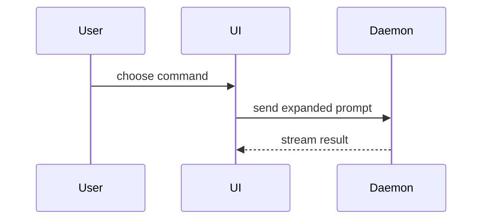

Write the body in two tiers. The top tier is what a reviewer reads first, in about two minutes: keep it under 250 words. Everything else goes in one collapsed `<details>` block below it.

````markdown
<The problem as the user saw it, in one or two sentences. Then what changed for them. Closes #<issue>.>

<A diagram, only when no image shows the change.>

## Evidence

<For each change, one line on what to look at, then:>

| Before | After |
| --- | --- |
|  |  |

**Proof:** <where the change ran, what was checked, and that the repo's check passes>

<optional: one review line>

**Not checked:**

- <only when something wasn't checked: one short item each>

**Door:** <one-way or two-way>. <why, in one sentence>

**Blast radius:** <one-word description>. <what breaks, and for whom, if this is wrong>

<details>
<summary><what it holds></summary>

<full screenshots, logs, commits, and anything else a reviewer may want>

</details>
````

## The top tier

Skip all preambles and keep prose brief. Use the user's domain language from `GLOSSARY.md`.

- **Problem, then change.** Open with what the user saw go wrong, in their words, then what they see now. For a fix whose cause isn't obvious, name the root cause in one sentence. The closing keyword goes here.
- **Evidence.** Each change gets one `| Before | After |` table, with both images cropped to the same region around the change. A change with several visible differences gets one image with each difference marked, and the full screenshots go in `<details>`. When the change shows in a terminal or an API rather than on screen, give a short fenced **Before:** and **After:** transcript in place of the table. A new behaviour has only an After.
- **Alt text** says what the reader sees in the image, such as "The results screen reading Score: NaN".
- **Proof** is one paragraph: where the change ran, such as the device, browser, simulator or seeded data, what you checked, and that the repo's check passes, by its command.
- **Review** gets one line at most, such as "Reviewed: two passes, every finding fixed."
- **Not checked** lists what wasn't verified, one short item each, such as a platform, a setting or a real device. Leave it out when nothing is left.
- **Door** and **Blast radius** close the top tier, as [merge danger](#merge-danger) describes.

Screenshots are S-tier when the environment is set up for it and the change is visual. A terminal transcript or an API response is A-tier. When a test is the only proof, show it in pseudocode as the test that now fails and passes.

How the change was built goes in `<details>`: commit SHAs, base and head bookkeeping, the story of earlier builds and review rounds, red and green assertion lines, log links and verifier output. The commit each capture was taken at sits beside the verification there. `issue-to-pr` checks a body with its `scripts/pr-body.mjs`, which refuses more than 400 words above the first `<details>`, a backticked commit SHA above it, and alt text that is a file name.

## Diagrams

Add a diagram only when no image shows the change, such as a logic, tooling or data-flow change. Pick the smallest view that makes the key point clear.

- Show logic or an algorithm as pseudocode:

```text
on(save)
  if content is unchanged
    return cached result
  write new content
  return fresh result
```

- Show runtime control flow as a call tree:

```text
submitForm
  createSession
    persistPrompt
    launchAgent
  navigateToSession
```

- Show UI structure as a component tree, including state and module boundaries that matter:

```text
<SessionPage> (apps/example/src/routes/session.tsx)
  useSessionEvents()
  <SessionToolbar>
    <RunSkillButton> (packages/ui)
```

- Show file responsibility or a broad refactor as a shallow file tree:

```text
src/
├── commands/       # parses user actions
├── sessions/       # owns session state
└── transport/      # sends API requests
```

- Show component interaction, control flow, or data flow with Mermaid:



- Use `diff` when the point is what changes and the surrounding shape already exists. Match the diff shape to the topic.

For a component change:

```diff
 <SessionPage>
   useSessionEvents()
   <SessionToolbar>
+    <RunSkillButton />
   <SessionTimeline>
+    <SkillResultCard />
```

For a file-layout change:

```diff
 src/
 ├── commands/
+│   └── show-me.ts       # expands the slash command
 ├── sessions/
-└── transport.ts
+└── transport/
+    ├── client.ts
+    └── stream.ts
```

For a call-tree or call-stack change:

```diff
 submitForm
   createSession
     persistPrompt
+    expandSkillMention
     launchAgent
-  navigateToSession
+  navigateToSession
+    subscribeToEvents
```

For a state or control-flow change:

```diff
 on(save)
-  write content
+  if content is unchanged
+    return cached result
+  write new content
+  invalidate cache
```

- Show the whole block when most of it is new, when omitted context would hide ownership or order, or when the user needs a copyable target shape:

```ts
function expandSkill(command: string): string {
  const skillName = command.slice(1);
  return `use the ${skillName} skill`;
}
```

### Guidance

Place each visual next to the short text it supports. Keep only the calls, files, props, states, and boundaries needed to answer the user's current question or the options to resolve the current discussion point.

You may use one of these or several. You will rarely use all of them. Use your judgement and don't overwhelm the user.

## Merge danger

Describe whether it's a one-way or two-way door. You can walk back through two-way doors, but not one-way doors. A PR that is cheap to roll back is lower risk. Changes that involve destructive actions or hard-to-reverse decisions are one-way doors.

The blast radius is the potential impact or scope of the changes introduced by this PR. Consider all possibilities. Examples are layout shift, breakages for consumers, mobile responsiveness, etc.

Write each as one line: the word, then one sentence. `/ship` reads the door from the `**Door:**` line.

## Worked example

A fix to a game's results screen:

````markdown
A round abandoned before it was scored showed "Score: NaN" on the results screen, so players thought the game had crashed. Now it shows a dash, and a scored round, zero included, still shows its score. Closes #7.

## Evidence

The score line after an abandoned round:

| Before | After |
| --- | --- |
|  |  |

**Proof:** Ran the web app on Chrome and Safari with three seeded rounds: the abandoned one shows a dash, and rounds scored 0 and 12 show 0 and 12. `pnpm check` passes.

Reviewed: one pass, no findings.

**Not checked:**

- The mobile app, which draws its own results screen.

**Door:** two-way. A revert brings back "NaN", and nothing stored changes.

**Blast radius:** results screen. If the dash check were wrong, a real score of zero would show as a dash.

<details>
<summary>Verification</summary>

Captured at `3f9c2ab`, the head, against base `a41e07d`.

| Check | Command | Result |
| --- | --- | --- |
| Lint, typecheck, tests | `pnpm check` | passed |
| Results screen test | `pnpm test results-screen` | red on the base: `expected "–", received "NaN"`; green at the head |

</details>
````
